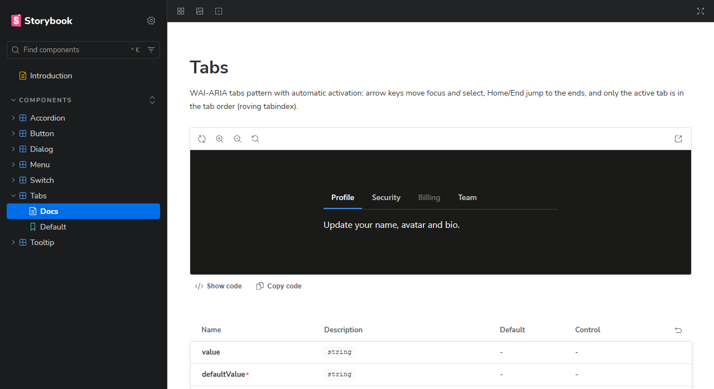

# Lumen UI

[](https://github.com/timmichael738/lumen-ui/actions/workflows/ci.yml)


**Accessible React components that follow the
[WAI-ARIA Authoring Practices](https://www.w3.org/WAI/ARIA/apg/).** Every component works with a
keyboard and a screen reader out of the box, is themed with CSS variables, and weighs about 3.5 kB gzipped.

### 👉 [Storybook docs](https://timmichael738.github.io/lumen-ui/)



## Components

| Component        | Pattern                                                                | Highlights                                                                                                                          |
| ---------------- | ---------------------------------------------------------------------- | ----------------------------------------------------------------------------------------------------------------------------------- |
| `Button`         | button                                                                 | Variants and sizes. `loading` sets `aria-busy` but keeps focus. Defaults to `type="button"`                                         |
| `Switch`         | [switch](https://www.w3.org/WAI/ARIA/apg/patterns/switch/)             | `role="switch"` + `aria-checked`, a clickable label, and an optional description                                                    |
| `Tabs`           | [tabs](https://www.w3.org/WAI/ARIA/apg/patterns/tabs/)                 | Roving tabindex, arrow/Home/End keys, skips disabled tabs, vertical orientation                                                     |
| `Accordion`      | [accordion](https://www.w3.org/WAI/ARIA/apg/patterns/accordion/)       | Real headings (configurable level), single or multiple open                                                                         |
| `Dialog`         | [modal dialog](https://www.w3.org/WAI/ARIA/apg/patterns/dialog-modal/) | Native `<dialog>` (top layer, focus trap), Escape, returns focus to the trigger                                                     |
| `Menu`           | [menu button](https://www.w3.org/WAI/ARIA/apg/patterns/menu-button/)   | Arrow keys, Home/End, typeahead, disabled items, closes on outside click                                                            |
| `Tooltip`        | [tooltip](https://www.w3.org/WAI/ARIA/apg/patterns/tooltip/)           | Shows on focus _and_ hover, Escape dismisses ([WCAG 1.4.13](https://www.w3.org/WAI/WCAG22/Understanding/content-on-hover-or-focus)) |
| `VisuallyHidden` | –                                                                      | Screen-reader-only text for icon-only controls                                                                                      |

All stateful components can be **controlled or uncontrolled** (`value`/`defaultValue` +
`onValueChange`, like native inputs).

## Usage

> The package is publish-ready as `@timmichael738/lumen-ui` (`npm publish` runs the build via
> `prepublishOnly`). Until it is published, try it locally with `npm run build && npm pack` and
> install the generated tarball.

```tsx
import { Button, Tabs, TabList, Tab, TabPanel } from '@timmichael738/lumen-ui';
import '@timmichael738/lumen-ui/styles.css';

<Tabs defaultValue="profile">
  <TabList label="Account settings">
    <Tab value="profile">Profile</Tab>
    <Tab value="security">Security</Tab>
  </TabList>
  <TabPanel value="profile">…</TabPanel>
  <TabPanel value="security">…</TabPanel>
</Tabs>;
```

## Theming

Everything is driven by `--lumen-*` CSS variables, with built-in light and dark values (following
the OS, or pinned with `data-theme="light|dark"`). Override any of them:

```css
:root {
  --lumen-accent: #7c3aed;
  --lumen-radius: 4px;
}
```

The styles also respect `prefers-reduced-motion` and Windows High Contrast (`forced-colors`).

## Quality

- **Behaviour tests** (Vitest + Testing Library) for every keyboard interaction in each pattern:
  focus movement, roving tabindex, typeahead, focus return, Escape handling, and controlled versus uncontrolled state.
- **Automated accessibility audits**: every component is checked with axe-core in the test suite,
  and live in Storybook's Accessibility panel.
- **Tiny and tree-shakeable**: ES modules only, React as a peer dependency, `sideEffects` limited to CSS.
- **Typed**: full `.d.ts` output generated from strict TypeScript.

## Development

```bash
npm install
npm run storybook     # http://localhost:6006
npm test
npm run build         # dist/index.js, dist/styles.css, dist/types
```

CI lints, type-checks, tests, builds the library and deploys Storybook to GitHub Pages.

## License

[MIT](LICENSE) © Michael Timothy
